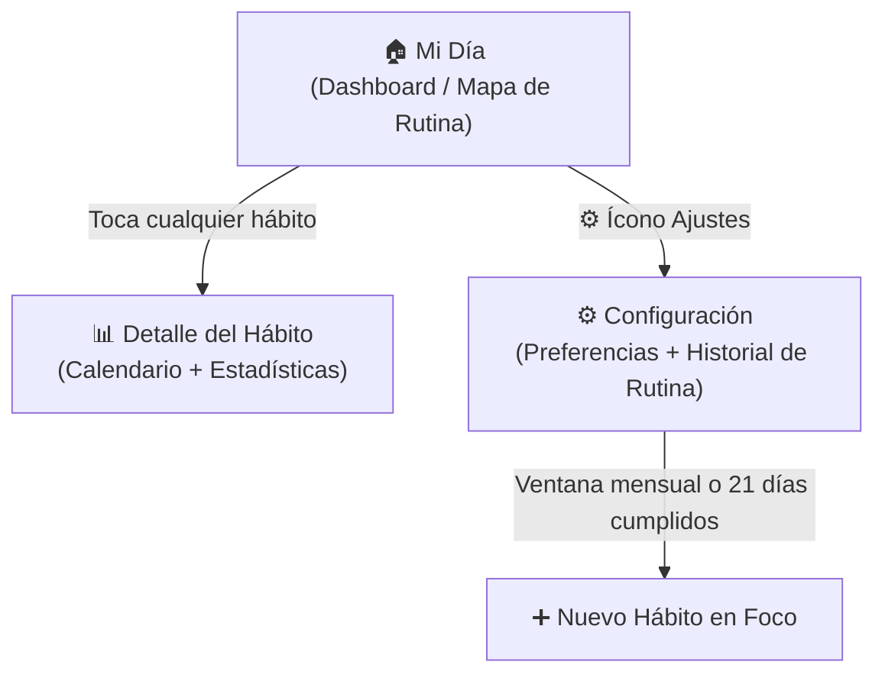
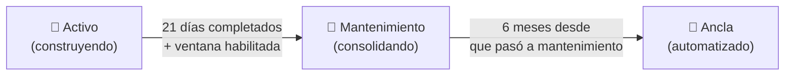
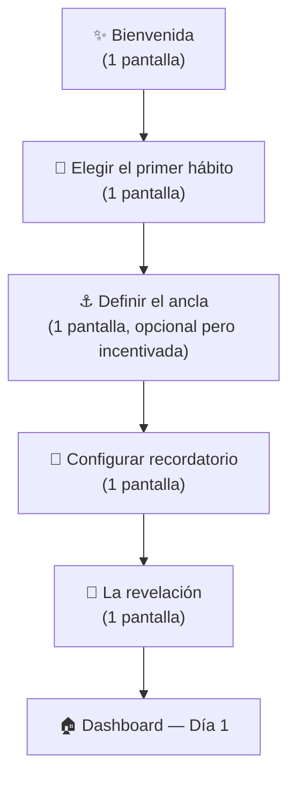
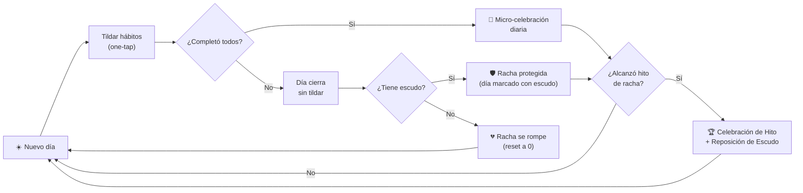

# Apliando Ando — Documento Conceptual de la App de Hábitos

> [!NOTE]
> Este documento es una referencia viva de las decisiones de diseño y reglas de negocio. Se actualiza a medida que el concepto evoluciona.

---

## Visión General

Una app de hábitos y rachas (*streaks*) desde un enfoque **amable, motivador y realista**. El principio guía no es la perfección, sino la **resiliencia**: cada vez que el usuario construye más camino, se vuelve más capaz de sostenerse.

---

## 1. El Hábito como unidad base

Cada hábito es una entidad independiente con su propio estado, racha y protección.

### Atributos de un Hábito

| Atributo | Descripción |
|---|---|
| **Nombre** | Texto libre (ej. "Caminar 20 minutos", "Leer") |
| **Icono / Color** | Identidad visual rápida |
| **Frecuencia** | **Diario.** Todos los hábitos son diarios (MVP). |
| **Ancla** | Hábito o rutina instalada a la que se vincula este hábito (opcional) |
| **Racha activa** | Días consecutivos completados |
| **Racha máxima histórica** | El récord personal del hábito |
| **Escudos disponibles** | Cantidad de días de gracia disponibles *para ese hábito específico* |
| **Stickers desbloqueados** | Colección de stickers ganados en hitos de este hábito |
| **Estado** | `Activo`, `Mantenimiento`, `Ancla (graduado)`, `Pausado temporalmente`, `Archivado` |

> [!IMPORTANT]
> Los escudos son **por hábito**, no globales. Un escudo gastado en "Lectura" no afecta los escudos de "Caminar". Cada hábito tiene su propia reserva de protección.

---

## 2. Sistema de Escudos (Días de Gracia)

### La filosofía del Escudo

La racha no se mide en "días perfectos", sino en **compromiso sostenido**. Un día fallado con escudo disponible simplemente se muestra como *protegido*, no como fracaso.

### Mecánica central y Flujo de Confirmación al Día Siguiente

- Cada hábito **comienza con 2 escudos**.
- El cierre del día ocurre a las **00:00 (medianoche)**.
- Si un hábito quedó sin tildar:

#### 1. Notificación matutina amable (en caso de tener escudos)
A la mañana siguiente (o en el primer ingreso del día), si hay un hábito pendiente de escudo:
> *"Ayer fue un día ocupado. Tenés 2 escudos disponibles para proteger tu racha de '[Nombre del Hábito]'. ¿Querés usar uno?"*

#### 2. Diálogo modal en la app (Bottom Sheet acogedor)
Al abrir la app, antes de operar en "Mi Día", se presenta una tarjeta suave e interactiva:

* **Tono del mensaje:** Amable, sin dramatismo ni alertas rojas.
  > *"A veces la vida se interpone, y está bien.*
  > *Ayer no registraste **[Nombre del Hábito]**.*
  > *¿Querés activar un escudo para cuidar tu camino?"*
* **Información contextual visible:**
  - Racha que se protege: ej. *"Mantendrías tus 14 días seguidos"*.
  - Estado del recurso: *"Te quedaría 1 escudo disponible"*.
* **Opciones de decisión:**
  - **Botón principal (Cálido):** *"Sí, usar escudo 🛡️"* $\rightarrow$ el día anterior se sella con el ícono de escudo, la racha continúa intacta y se actualiza el contador.
  - **Botón secundario (Texto plano):** *"No, empezar de nuevo"* $\rightarrow$ la racha se reinicia a 0 sin frases de culpa (*"Cada reinicio es una oportunidad para aprender qué ajustar"*), y el escudo se conserva para el futuro.
  - **Botón terciario/escape (o cerrar):** *"Decidir más tarde"* $\rightarrow$ el diálogo se pospone.

#### 3. Regla estricta de vencimiento
- La decisión permanece disponible como un banner sutil en la parte superior del Dashboard durante todo el día actual.
- **Límite de vencimiento:** Finaliza a las **23:59 del día siguiente**.
- Si el usuario no confirmó el uso antes de las 23:59, el escudo **no se cobra** y la racha se reinicia automáticamente al pasar a la jornada siguiente.

#### 4. Caso con múltiples hábitos pendientes (hábito activo + mantenimiento)
Para evitar saturar con 2 o 3 diálogos seguidos, se presenta un **resumen agrupado único**:
> *"Ayer no marcaste 2 hábitos. Podés proteger ambos con sus escudos correspondientes o elegir cuál cuidar."*
> - Checkbox simple por cada hábito con su escudo individual.
> - Botón único: *"Confirmar protección"*.

---

### Tope de escudos

- El máximo de escudos por hábito es **3** (para evitar que el sistema pierda sentido de esfuerzo).
- Los escudos no "caducan"; se acumulan hasta ese tope.

---

## 3. Sistema de Hitos y Celebración

### Hitos de Racha por Hábito

Los hitos se calculan sobre la racha activa de **cada hábito individual**, medida en **días consecutivos completados**.

| Hito | Días |
|---|---|
| Primera semana | 7 días |
| Hábito en formación | 14 días |
| El famoso "21 días" | 21 días |
| Primer mes | 30 días |
| Medio camino | 50 días |
| Tres meses | 90 días |
| El centenar | 100 días |
| *(abierto a más)* | 150, 180, 365... |

### Formato de celebración

Al alcanzar un hito, la app lanza una experiencia de festejo en dos capas:

1. **Visual / Emocional:** Pantalla de celebración completa con animación, confeti digital, frase personalizada y reconocimiento del logro específico (ej. *"¡21 días leyendo! Ya es parte de vos."*)
2. **Beneficio concreto — Reposición de Escudo:** Como parte del festejo, **se repone un escudo gastado** del hábito que alcanzó el hito.

> [!TIP]
> La reposición solo aplica si el hábito tiene menos de 3 escudos. Si ya está en el tope, el beneficio se comunica igual ("¡Seguís con tu protección completa!") para que la celebración no quede vacía.

### La filosofía de la reposición por hito

> *"A medida que consolidás tu camino, te volvés más resiliente."*

La reposición no es un regalo gratuito: es el reconocimiento de que quien ya lleva 21 días con un hábito ha demostrado suficiente constancia como para merecer una segunda oportunidad adicional. El esfuerzo sostenido **construye protección**.

#### Tensión deliberada (y por qué es buena)

Si el usuario se acerca a un hito con pocos o ningún escudo disponible, existe el riesgo de romper la racha justo antes de la meta. Esto es **intencional y positivo**:

- Genera un momento de atención consciente ("estoy cerca, quiero cuidar esto").
- Hace que la reposición al llegar al hito se sienta como una **recompensa ganada**, no automática.
- Evita que el sistema de protección se vuelva trivial o se use irresponsablemente.

---

## 4. Micro-celebraciones diarias

Independientemente de los hitos de racha, cada acción de tildado tiene su pequeña recompensa:

- **Al tildar un hábito individual:** Animación sutil de satisfacción (el ícono "pops", vibración suave, sonido corto opcional).
- **Al completar todos los hábitos del día:** Celebración más notoria — frase motivadora del día, pequeña animación en el dashboard.

Las frases deben reforzar constancia, no presión:
- *"Un día más. Eso es todo lo que hace falta."*
- *"Lo importante no es ser perfecto, es volver."*
- *"Cada día que sumás es tuyo para siempre."*

---

## 5. Arquitectura de Pantallas



### Pantalla 1 — "Mi Día" (Dashboard / Mapa de Rutina)

El corazón de la aplicación. No es una simple "to-do list", sino un **recorrido visual continuo de la rutina diaria** dividida claramente según el ciclo de vida de los hábitos.

#### 1. Encabezado superior
- **Saludo cálido y fecha actual:** (Ej. *"Buen día, Jesús — Martes 17 de noviembre"*).
- **Indicador general de progreso diario:** Barra o círculo sutil que muestra cuántos hábitos faltan tildar hoy (ej. *"1 de 2 completados"*).
- **Acceso a Ajustes:** Ícono `⚙️` discreto en la esquina superior derecha (sin botón flotante `+`, ya que la creación está regida por la filosofía de un hábito a la vez).

#### 2. La Cadena de Rutina (Cuerpo principal scrollable)
Los elementos se organizan cronológicamente siguiendo la técnica de *habit stacking*:

* **A. Anclas iniciales o graduadas (no tildables):**
  - Tienen una etiqueta distintiva `🌳 ANCLA`.
  - Fondo transparente o línea conectora punteada vertical hacia el siguiente bloque.
  - Para anclas de vida real: texto simple (ej. *"☕ Después del café mañanero"*).
  - Para hábitos graduados (que cumplieron 6 meses en mantenimiento): nombre del hábito + medalla/trofeo con su racha histórica consolidada (ej. *"Caminar 20 min · ✦ 287 días"*).

* **B. Hábitos en Mantenimiento (tildables, consolidados):**
  - Tienen una etiqueta sutil `🌿 MANTENIMIENTO`.
  - **Tarjeta visual compacta:** fondo suave pastel, nombre del hábito, racha actual en llamas/número (ej. *"🔥 45 días"*).
  - **Checkbox amplio:** toque rápido (one-tap) para marcar como completado ✅.
  - No muestran barra de hito hacia los 21 días (ya pasaron esa etapa), manteniendo la tarjeta visualmente limpia.
  - Al tocar la tarjeta (fuera del checkbox), se abre su pantalla de Detalle/Estadísticas.

* **C. El Hábito Activo (el protagonista central):**
  - Tiene una etiqueta destacada `🌱 EN CONSTRUCCIÓN`.
  - **Tarjeta con mayor jerarquía visual:** borde o sombra suave, color identificador asignado.
  - **Nombre del hábito + texto del ancla inmediata** (ej. *"↳ Después de Caminar 20 min"*).
  - **Indicador de Escudos:** Representación gráfica clara de la reserva (ej. `🛡️ 🛡️` disponibles, o `🛡️ ⚪` si usó uno).
  - **Mini barra de camino al hito:** *"Día 12 de 21"* con una barra de progreso que llena visualmente el trayecto.
  - **Checkbox protagónico:** botón amplio de tildado diario con micro-animación de celebración inmediata.

---

### Análisis crítico del diseño de "Mi Día"

> [!CAUTION]
> Puntos de fricción a tener en cuenta en esta pantalla.

**1. Sobrecarga de jerarquías visuales:**
Tener anclas de texto, anclas graduadas, hábitos en mantenimiento y el activo puede generar confusión si no se usan pesos tipográficos y espaciados muy limpios. La regla de diseño debe ser: *solo lo activo llama la atención de inmediato; el mantenimiento acompaña con calma.*

**2. Manejo de estados vacíos al inicio (Día 1 del usuario):**
El primer día, el usuario no tiene hábitos en mantenimiento ni anclas graduadas. Solo verá su ancla externa (si puso una) y la tarjeta grande de su único hábito activo. La pantalla debe sentirse acogedora y "liviana", no "vacía".

**3. ¿Qué pasa cuando todo está tildado?**
Al completar el último hábito del día, la pantalla no debe quedar estática: la barra superior se completa, se muestra una frase breve de cierre amable (ej. *"Rutina lista por hoy. Buen descanso."*) y las tarjetas pasan a un estado satisfecho/tenue.

### Pantalla 2 — Detalle del Hábito

- **Calendario mensual minimalista** con 3 estados visuales por día:
  - ✅ Cumplido
  - 🛡️ Protegido por escudo
  - ⬜ Vacío / no cumplido (roto o día futuro)
- **Estadísticas clave:** Racha actual · Racha máxima · Total de días cumplidos · Escudos disponibles · Próximo hito.
- **Barra de progreso hacia el próximo hito** (ej. *"Faltan 6 días para tu insignia de 21 días"*).

### Pantalla 3 — Configuración

- Lista editable de todos los hábitos (reordenar, pausar, eliminar).
- Ajustes generales: tema visual (claro/oscuro), notificaciones, sonidos.
- *(Futuro)* Exportar datos, sincronización, backup.

---

## 6. Principios de Diseño y UX

| Principio | Aplicación concreta |
|---|---|
| **Cero fricción diaria** | Registrar un hábito = 1 toque. Sin formularios. |
| **Foco en el progreso, no la perfección** | Los mensajes celebran el camino, no la racha perfecta. |
| **Estética acogedora** | Paleta cálida, tipografía amable, sin elementos agresivos o alarmantes. |
| **Transparencia del sistema** | El usuario siempre sabe cuántos escudos tiene y qué los recarga. |
| **Sin culpa** | La app nunca muestra mensajes de fracaso. Los días vacíos son neutrales. |

---

## 7. Decisiones Abiertas / Por Definir

> [!WARNING]
> Estos puntos necesitan una decisión antes de diseñar las pantallas en detalle.

- [x] ~~¿El escudo se activa automáticamente o el usuario lo confirma?~~ → **El usuario confirma.** La app notifica al día siguiente y el usuario decide conscientemente si gastar el escudo.

- [x] ~~¿Qué pasa con días pasados no registrados?~~ → **No se puede tildar retroactivamente.** Sin excepciones.

- [x] ~~¿Notificaciones?~~ → **Resuelto.** Una notificación diaria configurable (default 20:00) + notificación matutina si hay un escudo pendiente de confirmación.

- [x] ~~¿Los hábitos tienen frecuencia personalizada?~~ → **No. Solo hábitos diarios (MVP).** La racha se mide en días consecutivos.

- [x] ~~¿Las confirmaciones de escudo se agrupan o se presentan una por una?~~ → **Se agrupan.** Si fallan múltiples hábitos (ej. activo + mantenimiento), se muestra un diálogo unificado con lista de verificación para no generar fatiga de decisión.

- [x] ~~¿Hay hábitos "archivados"?~~ → **Resuelto.** Se implementan dos mecánicas distintas para cuidar la historia del usuario: **Pausa Temporal** (congela racha y contador por lesión/viaje) y **Archivado Definitivo** (desactiva el hábito sin borrar su historial ni sus stickers).

---

---

## 8. Análisis Crítico del Concepto

> [!CAUTION]
> Esta sección identifica tensiones, contradicciones y riesgos reales del diseño actual. No son ataques al concepto, sino problemas que hay que resolver antes de que se conviertan en deuda de producto.

---

### 🔴 Problema crítico: El escudo con confirmación rompe la promesa de "cero fricción"

**El problema:** La decisión de pedir confirmación para usar el escudo contradice directamente uno de los principios UX centrales de la app.

Si el usuario tiene 6 hábitos y falla 3 en el mismo día, al día siguiente se le presentan **3 confirmaciones de escudo separadas**. Eso no es cero fricción — es una pantalla de toma de decisiones emocionales a primera hora del día.

Peor aún: la confirmación asume que el usuario **abre la app al día siguiente**. Si vuelve 2 días después, ¿qué pasó con la confirmación pendiente? El sistema no tiene respuesta clara para ese caso.

**Lo que hay que definir:**
- ¿Cuántas horas después del cierre del día aparece la confirmación?
- ¿Hay un vencimiento? ("Si no confirmás en 24 horas, el escudo no se aplica y la racha se rompe.")
- ¿Se agrupan todas las confirmaciones en un solo flujo o aparecen una por una?

---

### 🟢 Resuelto: Sin retroactivo + notificaciones como mecanismo de seguridad

No se puede tildar retroactivamente. Sin excepciones. La contracara de esa rigidez es que **las notificaciones son el sistema de seguridad que lo hace viable**: si el usuario no abre la app, la notificación le recuerda que tiene hábitos pendientes antes de que el día cierre.

**Mecánica de notificaciones:**
- **Recordatorio diario:** Una notificación por día, a hora configurable globalmente por el usuario (ej. "20:00 — ¿Ya registraste tus hábitos?"). No por hábito individual, para no spamear.
- **Alerta de escudo pendiente:** Si el día anterior no se tildó un hábito y hay un escudo disponible esperando confirmación, la notificación del día siguiente incluye esa advertencia (ej. "Ayer no registraste 'Leer' — tenés un escudo disponible. ¿Lo usás?").
- Sin notificaciones no hay decisión consciente de escudo posible. Van juntas.

---

### 🟢 Resuelto: Frecuencia personalizable eliminada del MVP

Todos los hábitos son **diarios**. La racha se mide en días consecutivos completados. Esto elimina de un golpe:
- El problema del cálculo de racha en hábitos de frecuencia variable.
- La ambigüedad de qué protege un escudo en un hábito no diario.
- La confusión de "sesiones" vs "días" para el usuario.

La racha es simple: **N días seguidos sin fallo**. El usuario lo entiende sin que nadie se lo explique.

---

### 🟢 Resuelto: Stickers como recompensa alternativa en hitos

Cuando el usuario llega a un hito con los escudos ya llenos, la app desbloquea un **sticker coleccionable** temático vinculado al hábito y al hito alcanzado.

**Mecánica del sistema de stickers:**
- Cada hito (7, 14, 21, 30, 50, 90, 100 días) tiene un sticker único asociado por hábito.
- El sticker se desbloquea y se agrega a una **colección visual** accesible desde el detalle del hábito.
- Si el usuario tiene escudos disponibles para reponer → recibe la reposición del escudo.
- Si los escudos ya están llenos → recibe el sticker del hito.
- Ambas recompensas pueden coexistir (escudo + sticker) si el diseño lo permite, pero la prioridad narrativa de la celebración la tiene el escudo cuando se repone.

**Lo que falta definir:**
- ¿Los stickers son genéricos de la app o se personalizan por tipo de hábito?
- ¿Tienen alguna función más allá de ser coleccionables (ej. se pueden "pegar" en el perfil o compartir)?

---

### 🟢 Resuelto: Vencimiento de la confirmación del escudo → medianoche del día siguiente

El escudo se puede confirmar hasta las **23:59 del día siguiente** al fallo. Pasado ese límite, si no hubo confirmación, la racha se rompe. Simple y predecible para el usuario.

---

### 🟡 Tensión de diseño pendiente: El beneficio del hito es vacío cuando los escudos están llenos

**El problema:** La reposición de escudo como recompensa de hito solo funciona si el usuario tiene menos de 3 escudos. Si llega al hito con sus escudos completos (lo que ocurre cuando el usuario es constante, es decir, el mejor caso posible), el beneficio concreto no existe.

La app dice "seguís con tu protección completa" como salida, pero eso no es una recompensa — es la ausencia de una. Paradójicamente, **el usuario más dedicado recibe el peor festejo**.

**Resuelto con stickers:** Ver sección de stickers arriba. La tensión se cierra — el usuario con escudos llenos recibe el sticker del hito como recompensa alternativa. Queda pendiente definir si ambas recompensas pueden coexistir y qué tan coleccionables/funcionales son los stickers.

---

### 🟡 Tensión de diseño pendiente: Vencimiento de la confirmación del escudo

**El problema:** Se decidió que el escudo requiere confirmación del usuario. Pero si el usuario no abre la app al día siguiente, ¿cuándo vence esa confirmación pendiente?

Escenarios sin respuesta:
- El usuario no abre la app por 2 días seguidos. ¿El escudo del primer día todavía está disponible para confirmar?
- Si la notificación de escudo pendiente no se ve, ¿la racha queda en estado "indefinido" hasta que el usuario abra la app?
- ¿Se puede acumular más de una confirmación de escudo pendiente para el mismo hábito?

**Propuesta para discutir:** El escudo se puede confirmar hasta el final del día siguiente (medianoche). Pasado ese límite, si no hubo confirmación, la racha se rompe. Simple y predecible.

**→ Aceptado. Ver sección "Resuelto" arriba.**

---

### 🟠 Riesgo de producto pendiente: La confirmación de escudo sigue siendo fricción emocional

Incluso con hábitos diarios y notificaciones, la confirmación manual de escudos mantiene una fuente de fricción real: si el usuario falla 3 hábitos en el mismo día, al día siguiente enfrenta 3 micro-decisiones emocionales ("¿usé bien mi escudo?, ¿lo merezco?"). Eso puede sentirse como culpa disfrazada de elección.

**Pregunta sin respuesta definitiva:** ¿Las confirmaciones se presentan una por una (más peso emocional individual) o como un resumen grupal ("Fallaste 3 hábitos ayer — tenés escudos para todos. ¿Los usás?")?

---

## 9. Filosofía de Construcción: La Rutina que Crece

### El principio central

La app no es un gestor de listas de tareas disfrazado de hábitos. Su función es ayudar al usuario a **construir una rutina propia, capa por capa**, partiendo de lo que ya hace y sumando un nuevo hábito a la vez. Esto se basa en la técnica del *habit stacking* (apilamiento de hábitos), popularizada por James Clear en *Atomic Habits*.

La fórmula:
> *"Después de [algo que ya hago], voy a [hábito nuevo]."*

Con el tiempo, el dashboard deja de ser una lista de tareas y se convierte en el **mapa visual de la rutina del usuario**: anclas de vida real, hábitos graduados, hábitos en mantenimiento y el hábito que está construyendo ahora.

---

### El ciclo de vida de un hábito

Cada hábito recorre un camino de tres etapas:



| Etapa | Qué significa | En el dashboard | ¿Se tilda? |
|---|---|---|---|
| **🌱 Activo** | El hábito que se está construyendo ahora | Destacado, con barra de progreso y escudos | Sí |
| **🌿 Mantenimiento** | Hábito consolidado, aún en seguimiento | Visible, fondo suave, racha pero sin barra de hito | Sí |
| **🌳 Ancla** | Tan instalado que ya no necesita seguimiento | Aparece como texto de contexto, sin checkbox | No |

> [!IMPORTANT]
> Solo puede existir **un hábito activo a la vez**. Los hábitos en mantenimiento se tildan igual que antes, pero el foco — visual y emocional — está en el activo.

---

### La graduación a Ancla (6 meses en mantenimiento)

A los **6 meses de haber pasado a mantenimiento**, la app propone graduar el hábito a ancla:

> *"'Caminar 20 minutos' ya lleva 6 meses siendo parte de tu vida. Creemos que ya no necesitás registrarlo para hacerlo — es parte de quien sos. ¿Querés convertirlo en el ancla de tu siguiente hábito?"*

Si el usuario acepta:
- El hábito **deja de tener checkbox** en el dashboard.
- Su racha final queda congelada y visible como **trofeo** en el detalle histórico del hábito.
- Pasa a mostrarse como texto de contexto encadenado al hábito que sigue debajo.

Si el usuario prefiere seguir registrándolo:
- Puede elegir "Seguir registrando" y la app respeta esa decisión sin presión.
- La propuesta no vuelve a aparecer hasta el hito de 1 año.

> [!NOTE]
> Los **6 meses se cuentan desde que el hábito pasó a mantenimiento**, no desde que se creó. Si el usuario tardó 4 meses en agregar el segundo hábito, el reloj de 6 meses empieza desde ese momento.

---

### El Dashboard como rutina visible

El dashboard refleja la rutina completa en capas cronológicas:

```
🌳 Después del café mañanero      ← ancla externa (texto libre, siempre)
🌳 Caminar 20 min  ✦ 287 días     ← ancla graduada (trofeo de racha)
🌿 Leer 10 min     🔥 54 días     ← mantenimiento
🌱 Meditar 5 min   🔥 9 días  🛡️🛡️  ← activo
```

Ver esta cadena cada mañana no es una lista de pendientes — es el retrato de quién estás siendo. Cada hábito nuevo se engrana en lo que ya existe.

---

### Los dos momentos para sumar un hábito nuevo

#### Momento 1 — Al alcanzar los 21 días completados del hábito activo

La celebración del hito de 21 días incluye la invitación:
> *"¡21 días! Este hábito ya empieza a ser tuyo. ¿Querés ir pensando en qué hábito querés construir a continuación?"*

#### Momento 2 — El último día del mes: La Pantalla de Revisión Mensual

El último día del mes (al entrar a la app o al completar los hábitos del día), se desbloquea un ritual especial: la **Revisión del Mes**.

##### 1. El Resumen Visual del Mes (Estilo recuento amable)
- **Constancia global:** Total de días en los que se avanzó (ej. *"Completaste hábitos 26 de los 30 días este mes"*).
- **El estado de tu hábito activo:** Días acumulados, escudos utilizados (reconocidos como resiliencia, no como fallas) y stickers o hitos alcanzados.
- **Tu rutina en marcha:** Muestra el valor de los hábitos en mantenimiento y anclas consolidadas.

##### 2. El Portal de Decisión: Dos Caminos según los 21 días

* **Camino A: Tiene $\ge$ 21 días completados en el hábito activo**
  - **Mensaje de reconocimiento:**
    > *"¡Qué mes increíble! Tu hábito activo **'[Nombre]'** ya tiene 24 días de constancia real. Está listo para pasar a ser parte de tu rutina consolidada."*
  - **La propuesta:**
    > *"¿Querés sumar tu siguiente hábito para el mes que empieza?"*
  - **Opciones claras:**
    - **Botón principal:** *"Sí, sumar nuevo hábito"* $\rightarrow$ Pasa el hábito actual a `🌿 MANTENIMIENTO` y abre el flujo guiado para crear el nuevo `🌱 ACTIVO` (definiendo su ancla, color y nombre).
    - **Botón secundario:** *"Prefiero seguir solo con este un tiempo más"* $\rightarrow$ Se mantiene como activo sin presiones.

* **Camino B: Tiene menos de 21 días completados**
  - **No se habilita la creación de un nuevo hábito.**
  - **Mensaje de pedagogía y cuidado (sin culpa):**
    > *"Llevás 14 días construyendo **'[Nombre]'**. El cerebro necesita tiempo para que una conducta pase a modo automático. Agregar otro hábito ahora dividiría tu energía justo en la etapa donde más foco necesitás."*
    > *"El mes que viene, cuando este hábito ya sea parte natural de tus días, volvemos a abrir esta puerta. ¡Gran avance este mes!"*
  - **Botón único:** *"Seguir consolidando mi hábito"* $\rightarrow$ Regresa al Dashboard.

##### 3. Persistencia de la Revisión
Para que no sea invasiva, si el usuario la cierra o prefiere verla más tarde, queda un acceso directo con una tarjeta destacada en el Dashboard durante las últimas 24 horas del mes y las primeras 24 horas del mes entrante.

> [!NOTE]
> Si el usuario ya aceptó sumar un nuevo hábito al alcanzar el hito de los 21 días (Momento 1) durante ese mismo mes, la Revisión Mensual mantendrá su carácter celebratorio y de balance, pero no volverá a sugerir otro hábito, protegiendo la regla de oro: **solo un hábito activo en construcción a la vez**.

---

### ¿Qué pasa si el usuario intenta agregar un hábito fuera de las ventanas?

No hay botón `+` en el dashboard. Si el usuario busca agregar desde Configuración antes de que el hábito activo tenga 21 días completados, **la acción está bloqueada** sin posibilidad de continuar:

> *"Todavía estás construyendo '[nombre]'. Necesitás al menos 21 días para que tu cerebro empiece a automatizarlo. Volvé cuando llegues a esa marca — vale la pena esperar."*

El bloqueo es **absoluto y sin excepciones**. La app confía en su propia filosofía.

---

### Mecánica de Pausa Temporal y Archivado

La vida real ocurre: una lesión física, un viaje prolongado, una mudanza o simplemente un cambio de prioridades. Para no obligar al usuario a ver cómo se destruye una racha de meses sin culpa, la app distingue entre **Pausar** y **Archivar**:

#### 1. Pausa Temporal (El respiro consciente)
- **Para qué sirve:** Cuando el usuario sabe de antemano que por un tiempo limitado no podrá realizar el hábito (ej. gripe, esguince para salir a correr, vacaciones sin lectura técnica).
- **Cómo opera:**
  - El usuario activa la pausa desde el menú de opciones del hábito en Configuración o en la pantalla de Detalle.
  - El hábito entra en estado `⏸️ EN PAUSA`.
  - **Efectos:** La racha actual se **congela** exactamente en el número que tenía. Los escudos no se consumen. El contador hacia los 6 meses (si está en mantenimiento) o hacia los 21 días (si es el activo) queda en pausa.
  - **En el Dashboard:** Muestra una pequeña tarjeta en gris cálido con una insignia de pausa y un botón directo: *"Reanudar cuando estés listo"*.
  - **Límite de protección:** Para evitar que la pausa se vuelva un escondite eterno, a los 14 días la app envía un recordatorio empático: *"¿Cómo venís? Tu hábito sigue pausado esperándote"*.

#### 2. Archivado Definitivo (Cerrar etapas sin culpa)
- **Para qué sirve:** Cuando un hábito ya no tiene sentido en la vida del usuario (ej. "Estudiar para el examen final" una vez rendido, o una rutina que ya no encaja con su estilo de vida).
- **Cómo opera:**
  - Se archiva desde la Configuración del hábito.
  - **Efectos:** El hábito sale por completo del Dashboard "Mi Día".
  - **Preservación total del progreso:** No se borra ni se castiga. Sus estadísticas finales, su racha histórica máxima y todos los stickers/medallas desbloqueados quedan guardados para siempre en el **Historial de Rutina** (en Ajustes).
  - Si era el **hábito activo**, archivarlo libera inmediatamente la posibilidad de crear un nuevo hábito activo, sin tener que esperar a fin de mes ni a los 21 días (la energía se redirige a un nuevo comienzo).

---

### Análisis crítico de esta mecánica

> [!CAUTION]
> Tensiones que quedan abiertas.

**Tensión 1 — Los dos momentos de oferta pueden superponerse en el mismo mes.**
Resuelta con la regla de "no duplicar en el mismo mes", pero el comportamiento exacto de borde hay que definirlo en detalle.

**Tensión 2 — ~~¿Qué pasa si el hábito en mantenimiento se rompe antes de los 6 meses?~~ → Resuelto.**
Si la racha de un hábito en mantenimiento llega a 0 (sin escudo disponible), el **contador de 6 meses se pausa** hasta que el hábito se retome y la racha vuelva a crecer.

**Tensión 3 — ~~"No bloquea definitivamente" puede vaciar la filosofía.~~ → Resuelto.**
El bloqueo es absoluto. No hay válvula de escape por debajo de los 21 días.

**Tensión 4 — ~~El dashboard puede volverse muy largo con el tiempo.~~ → Resuelto.**
El dashboard muestra como máximo las **últimas 5 anclas/hábitos graduados**. Los más antiguos pasan a un **historial de rutina** accesible desde el detalle o desde Configuración, donde el usuario puede ver toda la cadena de hábitos que construyó desde que empezó a usar la app.

---

## 10. Onboarding: La Primera Vez

### El desafío central

El usuario llega esperando una app de hábitos típica. Va a encontrar algo diferente: solo puede empezar con un hábito, hay una restricción de 21 días, y se le pregunta por una "ancla" que probablemente no sabe qué es. Si la app le explica todo esto *antes* de que tenga algo propio en juego, va a leer sin escuchar. Si se lo explica *después* de que ya eligió su primer hábito, ya tiene piel en el juego y la filosofía le habla directamente.

**La decisión de diseño clave:** La filosofía se revela *después* de la configuración inicial, no antes.

---

### Flujo de Onboarding: 5 pasos



---

### Paso 1 — Bienvenida

Una sola pantalla. Sin texto largo. Sin lista de features. Una frase que define el tono de todo lo que sigue:

> *"Los hábitos no se construyen de golpe.*
> *Se construyen de a uno, despacio, sin prisa.*
> *Acá vas a empezar por el primero."*

Botón único: **"Empezar"**

> [!NOTE]
> Sin carrusel de slides explicativos, sin "conocé las features". La app demuestra lo que es haciéndolo, no describiéndolo.

---

### Paso 2 — Elegir el primer hábito y su identidad visual

Una pregunta directa, en tono cálido:

> *"¿Qué hábito querés empezar a construir?"*

- Campo de texto libre con placeholder: *"Ej: Leer 10 minutos, Tomar agua, Salir a caminar..."*
- 4–6 sugerencias rápidas como chips seleccionables para quien no sabe por dónde empezar.
- **Selector sutil de color:** Una fila con 4 tonos suaves/pastel preseleccionables (ej. salvia, terracota, lavanda, arena) para darle identidad visual de inmediato sin agregar pasos extra ni sobrecargar.

Botón: **"Este es"**

---

### Paso 3 — Definir el ancla

Acá se introduce el concepto de ancla de forma implícita, a través de la pregunta:

> *"¿A qué momento de tu día lo podés enganchar?"*
> *"Los hábitos nuevos se instalan mejor cuando los atás a algo que ya hacés sin pensarlo."*

- Campo de texto libre con placeholder: *"Ej: Después del café, cuando llego a casa, antes de dormir..."*
- Sugerencias rápidas: "Después del desayuno", "Al llegar al trabajo", "Antes de dormir", "Con el mate", "Después del almuerzo"
- Botón secundario: **"Prefiero no anclar por ahora"** — para no bloquear a quien no tiene claro su ritmo diario.

Botón principal: **"Perfecto"**

> [!NOTE]
> El nombre "ancla" no aparece en ningún momento de este paso. El usuario aprende el concepto haciéndolo, sin necesidad de aprender el término.

---

### Paso 4 — Configurar el recordatorio

> *"¿A qué hora querés que te recordemos revisar tus hábitos?"*

- Selector de hora simple (rueda o input).
- Valor sugerido por defecto: **20:00** — antes de que termine el día, con tiempo suficiente para tildar si no lo hizo.
- Texto de apoyo: *"Una notificación por día. Sin spam."*

Botón: **"Listo"**

---

### Paso 5 — La revelación (Secuencial: una a una)

Este es el momento más importante del onboarding. El usuario ya tiene su hábito configurado y su ancla elegida. Para garantizar que las reglas se asimilen sin saturar ni permitir un salto apresurado, la app presenta **3 tarjetas interactivas secuenciales (una a una)** con animación de transición limpia:

**Tarjeta 1: 🌱 Un hábito a la vez**
> *"Esta app solo te deja tener un hábito activo a la vez. No es una limitación, es para asegurar que este hábito nuevo realmente se instale en tu vida."*
> Botón: **"Entendido"** (pasa a la tarjeta 2)

**Tarjeta 2: 🛡️ Tus escudos de protección**
> *"Empezás con 2 escudos para cuidar tu racha si tenés un día complicado. No buscamos perfección, sino constancia. Los escudos se recargan al festejar hitos."*
> Botón: **"Siguiente"** (pasa a la tarjeta 3)

**Tarjeta 3: 📅 La meta de 21 días**
> *"Cuando lleves 21 días cumpliendo '[nombre del hábito]', recién ahí te invitaremos a sumar el siguiente. Hasta entonces, este es tu único foco."*
> Botón: **"¡Empecemos!"** (desbloquea y lleva al Dashboard)

---

### Por qué este orden funciona

| Decisión | Razón |
|---|---|
| Filosofía al final, no al principio | El usuario tiene su hábito puesto antes de leer las reglas. Las reglas le hablan *a su hábito*, no en abstracto. |
| Revelación en tarjetas secuenciales | Evita el escaneo rápido sin leer; cada principio se procesa individualmente en 3 segundos. |
| Paleta mínima en Paso 2 (Opción B) | Da pertenencia e identidad visual desde el primer segundo sin crear fricción cognitiva. |
| El ancla se enseña con una pregunta, no con una definición | "¿A qué momento lo anclás?" es más claro que "Definí tu ancla de hábito". |
| La restricción de 21 días se presenta como un camino, no como un muro | "En 21 días te preguntamos si querés sumar otro" suena a promesa, no a bloqueo. |
| Un solo botón por pantalla | Cero decisiones paralelas. El usuario avanza sin fricción. |
| Sin pedido de cuenta o email al inicio | La app se usa antes de cualquier registro. El registro (si existe) va después del primer día. |

---

### Análisis crítico del onboarding

> [!CAUTION]
> Tensiones evaluadas y resueltas.

**Tensión 1 — ~~El usuario que salta la lectura del Paso 5~~ → Resuelto.**
Al presentar las 3 tarjetas de a una con un botón de avance por tarjeta, el usuario debe interactuar con cada principio (1 hábito activo, 2 escudos, meta de 21 días) de forma secuencial y enfocada, reduciendo al mínimo el riesgo de abandono o confusión posterior.

**Tensión 2 — ~~¿Qué pasa con el icono y color del hábito?~~ → Resuelto (Opción B).**
Se integró una selección de 4 tonos pastel directos en el paso 2. El hábito nace con identidad visual propia sin añadir pasos extra.

**Tensión 3 — El usuario sin rutina clara no sabe qué poner como ancla.**
Alguien con un día muy variable (trabajos irregulares, maternidad, etc.) puede no tener un "momento fijo" al cual anclar. El botón *"Prefiero no anclar por ahora"* evita que se sienta frustrado de entrada, permitiéndole arrancar igual y agregar el ancla más adelante si lo desea.


