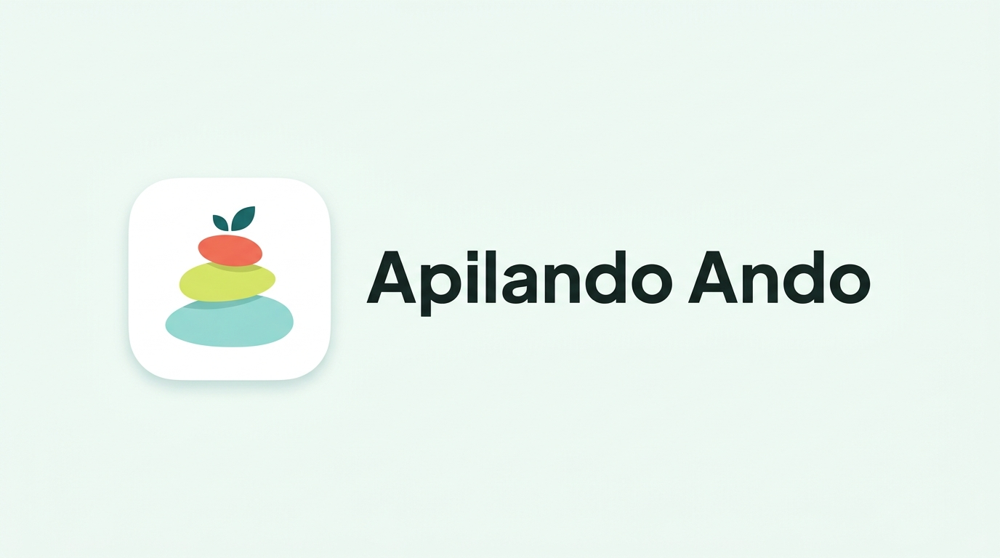
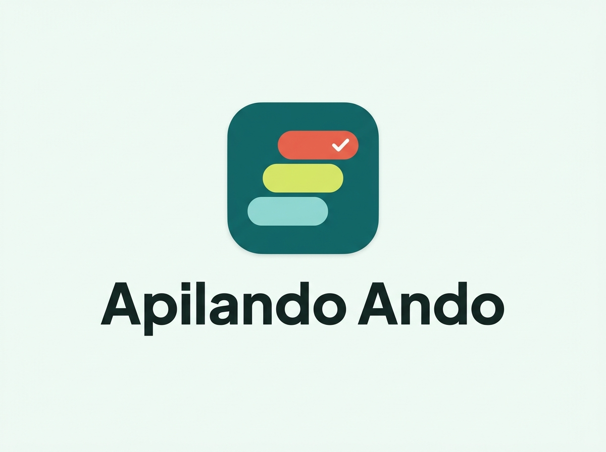
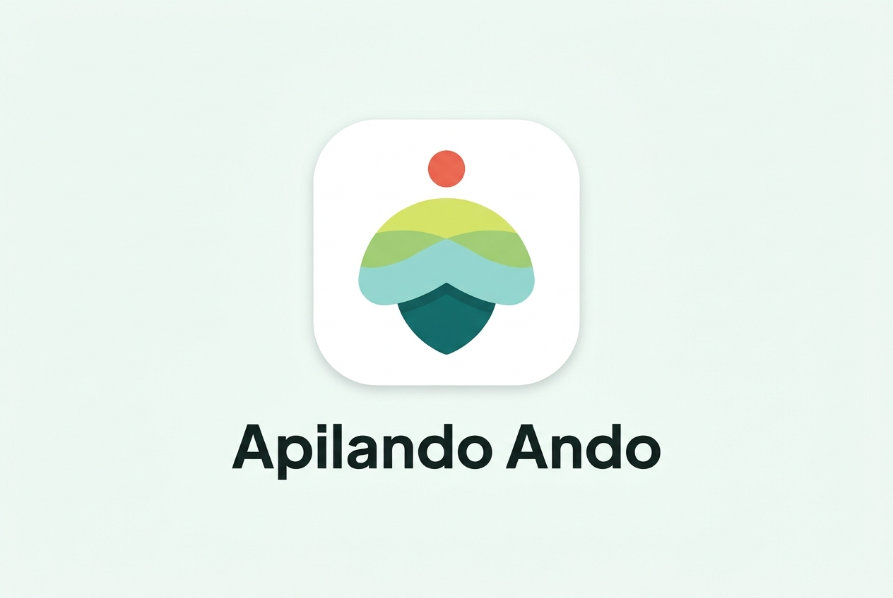
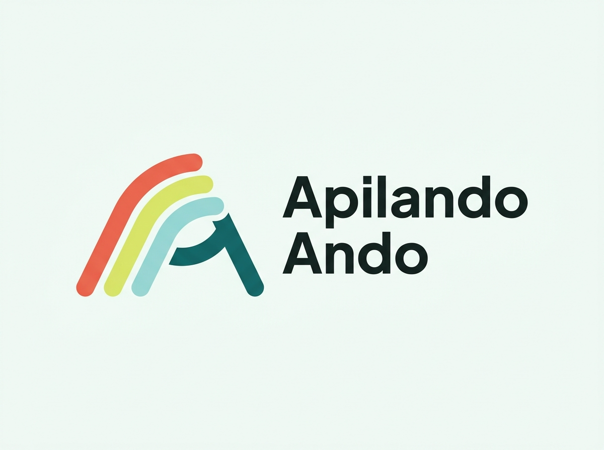

# Propuestas de Logo — Apilando Ando

Todas las propuestas respetan la paleta actual de la app (`#F7FBF9` Menta crema, `#121E1C` Bosque oscuro, `#166664` Aqua profundo, `#8FD6D3` Aqua, `#D6E85A` Lima y `#E85B4A` Coral) y una tipografía geométrica cálida alineada con **Plus Jakarta Sans**.

> **Opción elegida:** Propuesta 1 — *Piedritas Zen y Brote* (integrada en los íconos oficiales y pantallas de la app).

---

## 1. Piedritas Zen y Brote *(Elegida)*

Equilibrio orgánico, calma y crecimiento sin culpa (guijarros apilados + brote 🌱). Transmite bienestar, constancia diaria y suavidad.

## 2. Bloques de Hábitos en Escalera

Representa literalmente el *habit stacking*: pasos diarios que se suman con un check amigable. Muy legible como ícono pequeño en la pantalla del celular.

## 3. Copa de Árbol y Escudo en Capas

Une en un solo emblema el crecimiento (🌱 → 🌿 → 🌳) y la protección sin culpa (capas en forma de escudo amable + semilla/sol coral).

## 4. Monograma "A" en Movimiento

Marca editorial moderna: 3 trazos apilados que forman una **A** inclinada hacia adelante, transmitiendo acción constante (*"Ando"*).

